

<h1>Jorge Pérez Burgueño</h1>

<b>Historiador · Investigador predoctoral en la Universidad de Castilla-La Mancha</b> Historia cultural y contemporánea · Historia de la fotografía · Humanidades digitales

  
  
  
  
  
  
  

<a href="https://github.com/jorgepb96">English</a> · <b>Español</b>

## Sobre mí

Soy historiador e investigador predoctoral en la [Universidad de Castilla-La Mancha](https://www.uclm.es/) y miembro del grupo de investigación [CONFLUENCIAS](https://www.uclm.es/es/toledo/Humanidades/Investigacion/CONFLUENCIAS). Trabajo en historia cultural y contemporánea: historia social, franquismo, relatos de viaje, turismo e historia de la fotografía.

En mi tesis doctoral analizo cómo los viajeros extranjeros construyeron la imagen de España durante el franquismo a través de textos, fotografías y materiales efímeros. Combino el análisis histórico, el análisis del discurso y métodos cuantitativos aplicados a la cultura visual.

- **Historia de la fotografía y cultura visual.** Imágenes, representaciones e imaginarios sobre España en la mirada extranjera.
- **Relatos de viaje y turismo en el franquismo.** Textos, fotografías y materiales efímeros como fuentes para la historia contemporánea.
- **Humanidades digitales e inteligencia artificial.** Métodos cuantitativos y herramientas digitales para el estudio de fuentes históricas.

## Software para la investigación

También diseño y desarrollo aplicaciones pensadas para la investigación. Nacen de problemas que encuentro en mi propio trabajo con fuentes y están hechas para investigadores, docentes y estudiantes que se encuentran con los mismos.

> [!NOTE]
> **La investigación debe ser abierta.** Por eso todas las aplicaciones de Nodus son gratuitas, sin cuentas, anuncios ni suscripciones, y su código fuente es público. Nodus Research, Nodus Imago, Nodus Reader y Nodus Presenter tienen licencia [GNU AGPL-3.0](https://www.gnu.org/licenses/agpl-3.0.html); Nodus Drift usa la licencia MIT. Tus datos se quedan en tu ordenador.

###  Nodus Research

**Un espacio de trabajo de investigación de código abierto y local** para macOS, Windows y Linux. Reúne fuentes, notas, datos, ideas y materiales de aprendizaje, y da a cada proyecto un *vault* adaptado al trabajo que contiene:

- **Académico.** Crea un corpus desde Zotero y convierte la lectura en conocimiento conectado para tu revisión bibliográfica: búsqueda semántica, grafo de ideas, temas, acuerdos y contradicciones, análisis de lagunas, mapas argumentales, Deep Research y redacción con citas verificables.
- **Genealogía.** Árboles, cronologías, mapas y documentos que mantienen cada relación ligada a su prueba, con importación y exportación GEDCOM.
- **Bases de datos.** Campos tipados, relaciones, fórmulas, vistas y columnas asistidas por IA para proyectos que no caben en una hoja de cálculo.
- **Estudio.** Asignaturas, lecturas, apuntes y grabaciones, con bancos de preguntas, tests de práctica, tarjetas y repaso espaciado.
- **Docencia.** Cursos, horarios, materiales, cuadernos de notas, rúbricas y exámenes. Las listas de alumnos, las notas y las respuestas nunca se envían a un modelo de IA.

La IA puede funcionar en local o con el proveedor que elijas. No hace falta crear una cuenta.

**[Web](https://nodusresearch.com/) · [Descargar](https://github.com/jorgepb96/nodus/releases/latest) · [Recorrido interactivo](https://nodusresearch.com/demo/) · [Código fuente](https://github.com/jorgepb96/nodus)**

<table>
  <tr>
    <td align="center" width="33%"><a href="https://github.com/jorgepb96/nodus">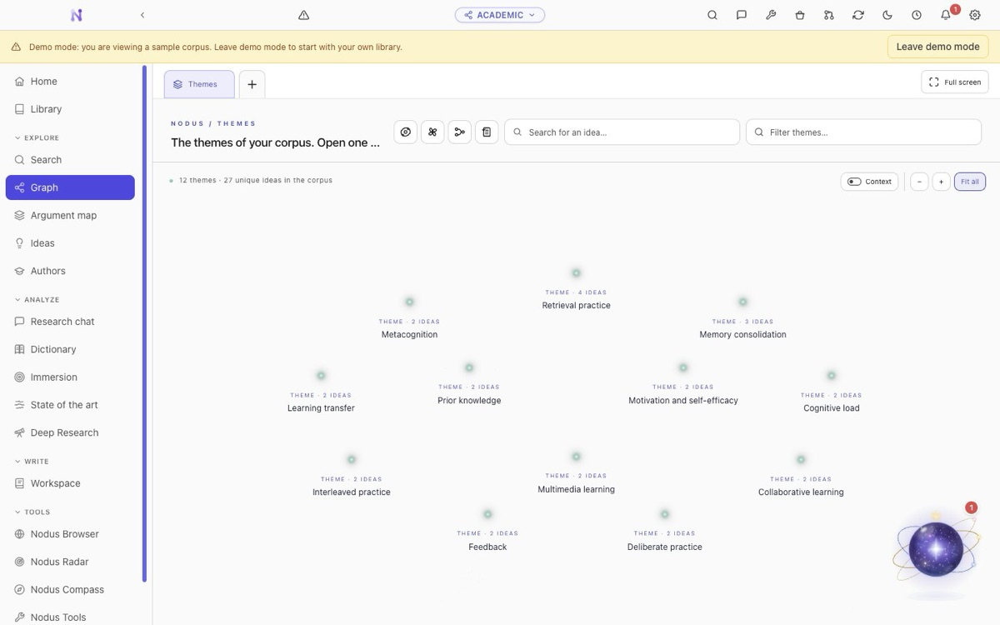</a> Vault académico: grafo de temas</td>
    <td align="center" width="33%"><a href="https://github.com/jorgepb96/nodus">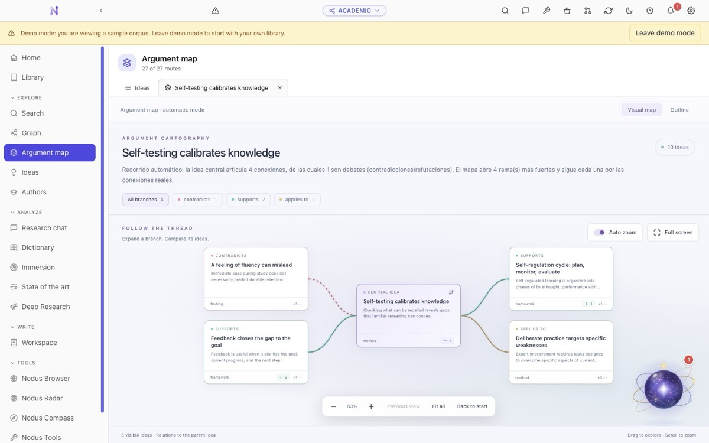</a> Mapa argumental</td>
    <td align="center" width="33%"><a href="https://github.com/jorgepb96/nodus">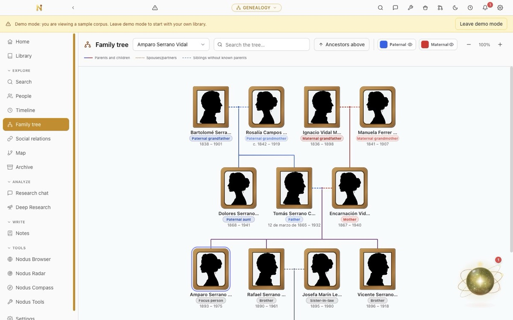</a> Vault de genealogía</td>
  </tr>
  <tr>
    <td align="center" width="33%"><a href="https://github.com/jorgepb96/nodus">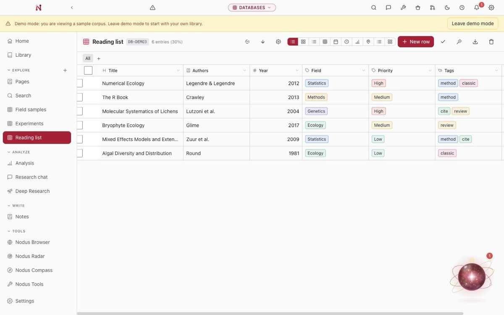</a> Vault de bases de datos</td>
    <td align="center" width="33%"><a href="https://github.com/jorgepb96/nodus">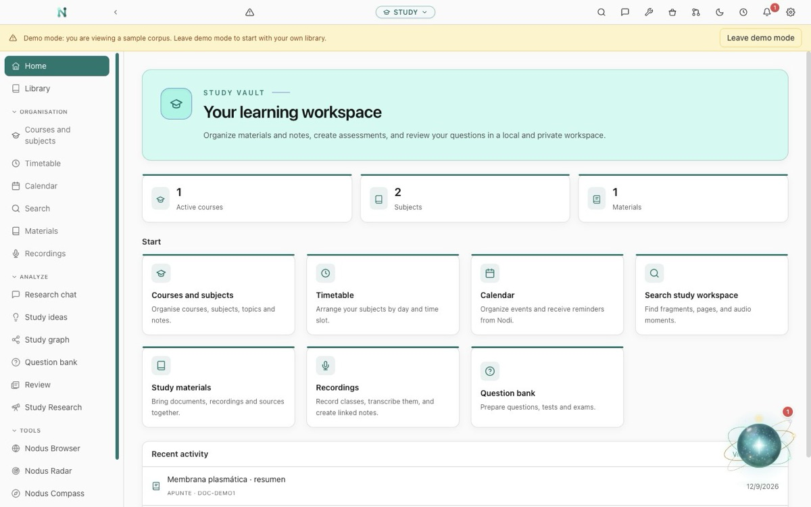</a> Vault de estudio</td>
    <td align="center" width="33%"><a href="https://github.com/jorgepb96/nodus">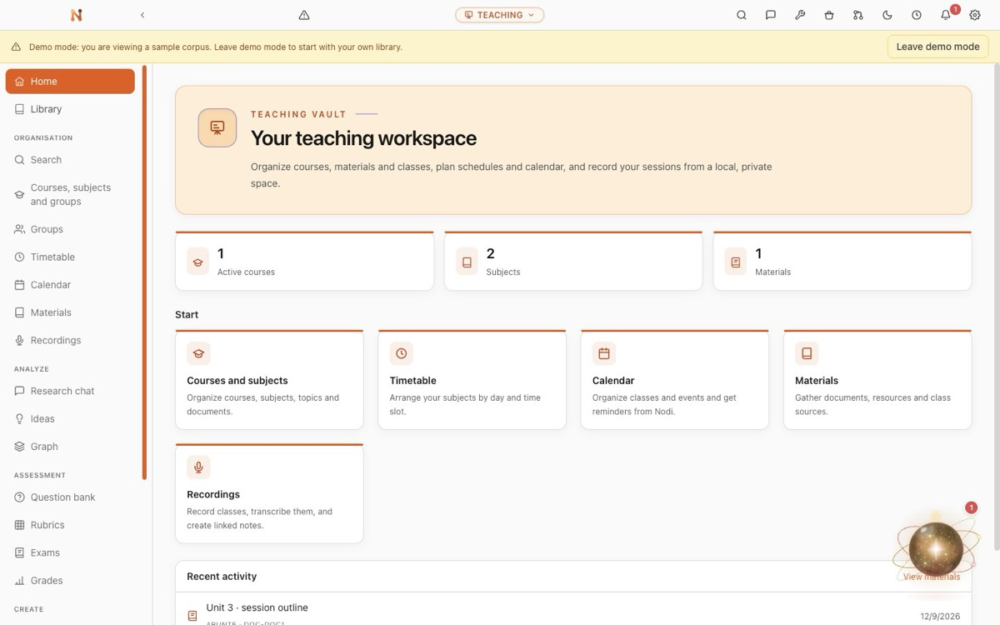</a> Vault de docencia</td>
  </tr>
</table>

###  Nodus Imago

**La aplicación más cercana a mi investigación.** Nodus Imago es una aplicación de escritorio de código abierto para trabajar con fotografías, grabados y otras fuentes visuales. Está pensada para historiadores, historiadores del arte, archiveros y cualquiera que gestione una colección visual.

- **Catalogar.** Crea bases de datos de imágenes con tus propios campos. Importa desde CSV, Tropy, manifiestos IIIF, Notion o Nodus. Las fechas se guardan como las escribe quien cataloga («c. 1860», «años 50») y funcionan en filtros y cronologías.
- **Buscar por texto y por imagen.** Encuentra imágenes por palabras exactas, por significado o con otra imagen. Marca un detalle y búscalo dentro de todas las demás fotografías.
- **Describir con IA.** Genera descripciones, etiquetas con tu propio vocabulario y transcripciones de reversos, sellos y pies de foto. Cada resultado es una propuesta que tú apruebas.
- **Restaurar.** Crea versiones restauradas, reparadas o coloreadas que se guardan aparte del original.
- **Comparar fotografías históricas.** Encuentra otras copias y recortes de la misma fotografía, superponlas y coloca una vista junto a imágenes actuales en *Antes y ahora*.
- **Analizar.** Frecuencias, tablas cruzadas con chi cuadrado y V de Cramér, coocurrencias, tendencias y acuerdo entre clasificaciones.
- **Mapa, cronología y red.** Sitúa las imágenes en un mapa con la dirección de la cámara, ordénalas por periodo y descubre qué lugares, personas y temas aparecen juntos.
- **Enlazar y citar.** Vincula registros con Wikidata, Getty e Iconclass, y copia citas en Chicago, ISO 690 o APA.

IA local o el proveedor que elijas, en macOS, Windows y Linux.

**[Descargar](https://github.com/jorgepb96/nodus-imago/releases/latest) · [Código fuente](https://github.com/jorgepb96/nodus-imago)**

<table>
  <tr>
    <td align="center" width="33%"><a href="https://github.com/jorgepb96/nodus-imago">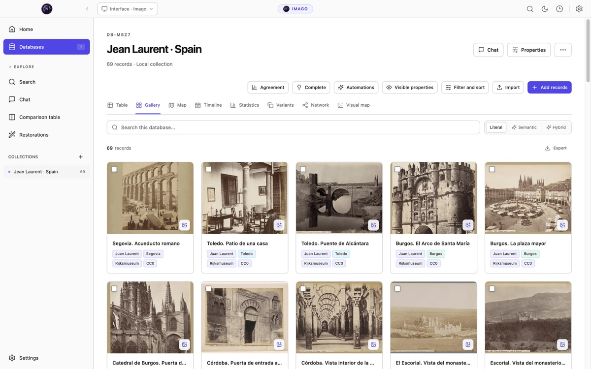</a> Galería del catálogo</td>
    <td align="center" width="33%"><a href="https://github.com/jorgepb96/nodus-imago">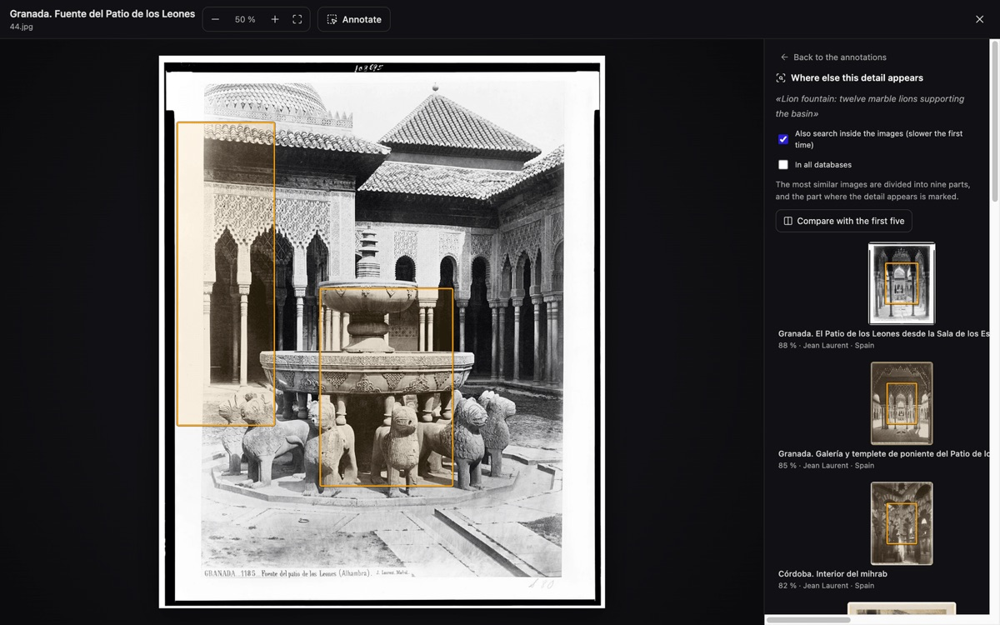</a> Búsqueda de un detalle en otras fotografías</td>
    <td align="center" width="33%"><a href="https://github.com/jorgepb96/nodus-imago">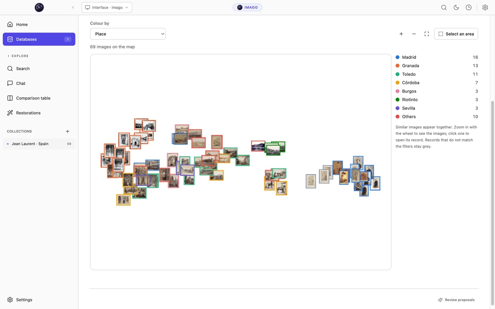</a> Mapa visual de la colección por similitud</td>
  </tr>
  <tr>
    <td align="center" width="33%"><a href="https://github.com/jorgepb96/nodus-imago">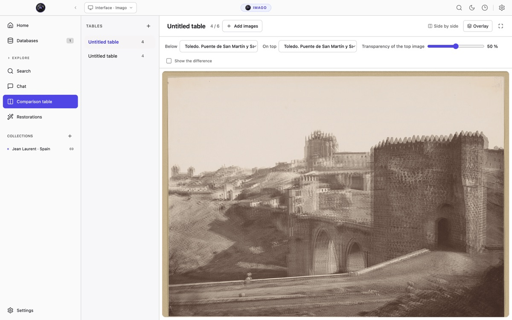</a> Dos copias de la misma vista superpuestas</td>
    <td align="center" width="33%"><a href="https://github.com/jorgepb96/nodus-imago">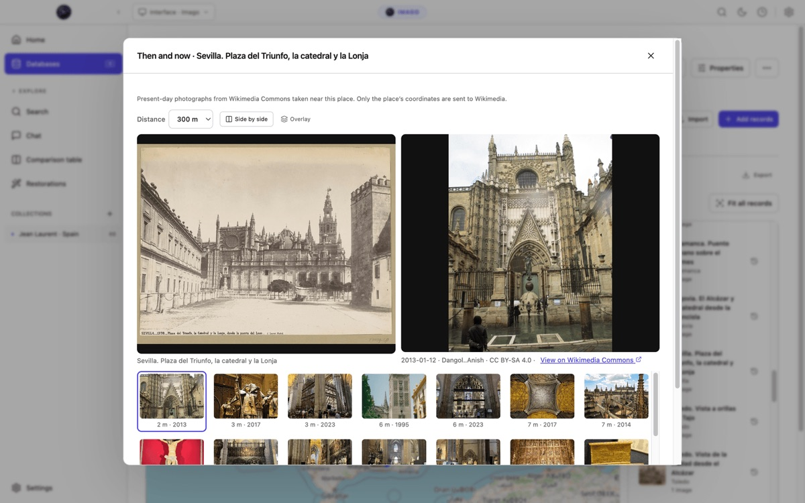</a> Antes y ahora</td>
    <td align="center" width="33%"><a href="https://github.com/jorgepb96/nodus-imago">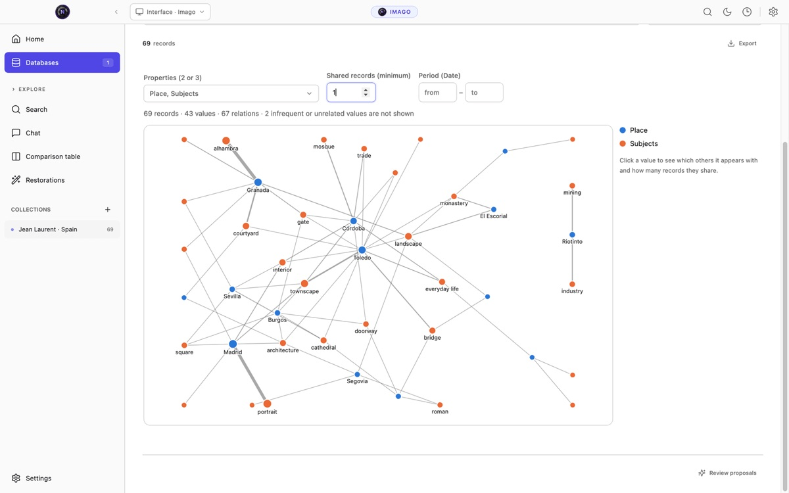</a> Red de lugares y temas</td>
  </tr>
</table>

Las capturas muestran fotografías de Jean Laurent y su estudio procedentes de colecciones públicas. Consulta los [créditos de las imágenes](https://github.com/jorgepb96/nodus-imago/blob/main/docs/screenshots/README.md).

### Aplicaciones móviles

El ecosistema Nodus continúa en iPhone y iPad.

<table>
  <tr>
    <td width="50%" valign="top"> <b><a href="https://github.com/jorgepb96/nodus-mobile">Nodus Link</a></b> · iPhone · iPad Tu Nodus Research en cualquier lugar: informes de Deep Research, ideas y notas, el diccionario y los pódcast, con una conexión privada a tu ordenador. <a href="https://github.com/jorgepb96/nodus-mobile">Repositorio</a></td>
    <td width="50%" valign="top"> <b><a href="https://github.com/jorgepb96/nodus-reader">Nodus Reader</a></b> · iPhone · iPad · Mac pronto Lee EPUB y PDF con subrayados y notas, y escucha tu biblioteca con voces de IA que funcionan en tu dispositivo. <a href="https://testflight.apple.com/join/SjCk8AZ1">Beta en TestFlight</a></td>
  </tr>
  <tr>
    <td width="50%" valign="top"><a href="https://github.com/jorgepb96/nodus-presenter">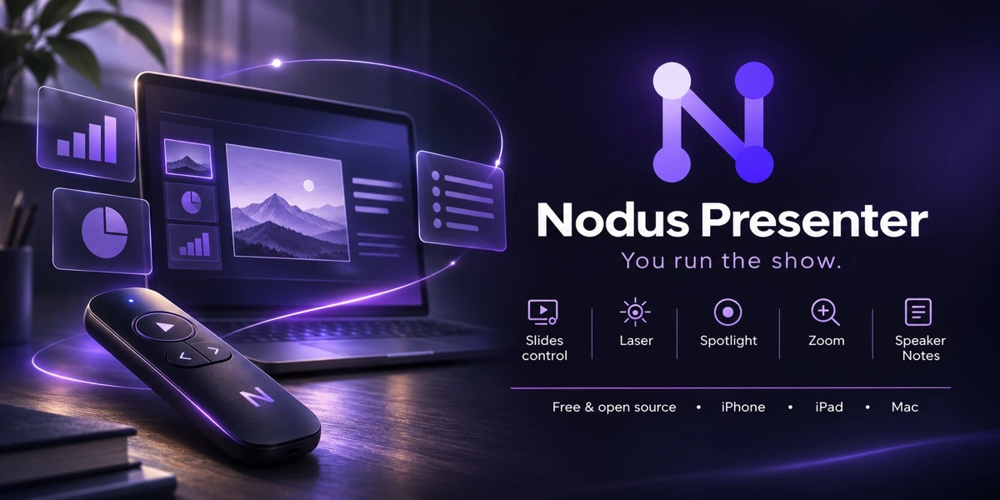</a> <b><a href="https://github.com/jorgepb96/nodus-presenter">Nodus Presenter</a></b> · iPhone · iPad Controla las presentaciones de Nodus Research desde el móvil: diapositivas, notas del orador, láser, foco y zoom. <a href="https://apps.apple.com/es/app/nodus-presenter/id6818107823">App Store</a></td>
    <td width="50%" valign="top"><a href="https://github.com/jorgepb96/nodus-drift">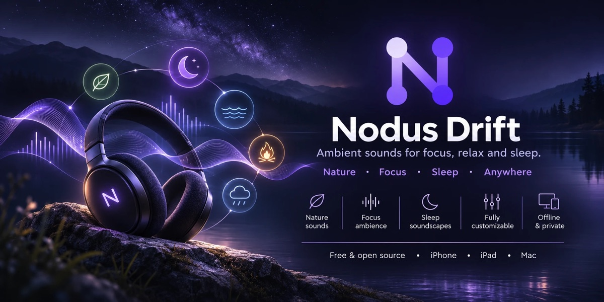</a> <b><a href="https://github.com/jorgepb96/nodus-drift">Nodus Drift</a></b> · iPhone · iPad Sonidos ambientales para concentrarte, descansar y dormir: 89 sonidos, mezclas de hasta seis y sin conexión. <a href="https://testflight.apple.com/join/kAXnsjJS">Beta en TestFlight</a></td>
  </tr>
</table>

---

Si Nodus te resulta útil, una estrella en sus repositorios ayuda a que otros investigadores lo encuentren.

