

<h1>Jorge Pérez Burgueño</h1>

<b>Historian · Predoctoral researcher at the University of Castilla-La Mancha</b> Cultural and contemporary history · History of photography · Digital humanities

  
  
  
  
  
  
  

<b>English</b> · <a href="https://github.com/jorgepb96/jorgepb96/blob/main/README.es.md">Español</a>

## About me

I'm a historian and predoctoral researcher at the [University of Castilla-La Mancha](https://www.uclm.es/) and a member of the [CONFLUENCIAS](https://www.uclm.es/es/toledo/Humanidades/Investigacion/CONFLUENCIAS) research group. My work sits in cultural and contemporary history: social history, the Franco dictatorship, travel writing, tourism and the history of photography.

My doctoral thesis studies how foreign travellers built the image of Spain during the Franco regime through texts, photographs and ephemera. It combines historical analysis, discourse analysis and quantitative methods applied to visual culture.

- **History of photography and visual culture.** Images, representations and imaginaries of Spain through foreign eyes.
- **Travel writing and tourism under Franco.** Texts, photographs and ephemera as sources for contemporary history.
- **Digital humanities and AI.** Quantitative methods and digital tools for the study of historical sources.

## Software for research

I also design and build applications for research. They start from problems I meet in my own work with sources, and they are made for researchers, teachers and students who meet the same ones.

> [!NOTE]
> **Research should be open.** That is why every Nodus app is free and open source, with no accounts, ads or subscriptions. Nodus Research, Nodus Imago, Nodus Link, Nodus Reader and Nodus Presenter are licensed under the [GNU AGPL-3.0](https://www.gnu.org/licenses/agpl-3.0.html); Nodus Drift uses the MIT licence. Your data stays on your computer.

###  Nodus Research

**An open-source, local-first research workspace** for macOS, Windows and Linux. It brings sources, notes, data, ideas and learning materials together, and gives each project a *vault* shaped for the work it holds:

- **Academic.** Build a corpus from Zotero and turn reading into connected knowledge for your literature review: semantic search, an idea graph, themes, agreements and contradictions, gap analysis, argument maps, Deep Research and writing with verifiable citations.
- **Genealogy.** Family trees, timelines, maps and records that keep every relationship tied to its evidence, with GEDCOM import and export.
- **Databases.** Typed fields, relations, formulas, views and AI-assisted columns for projects that don't fit in a spreadsheet.
- **Study.** Subjects, readings, class notes and recordings, with question banks, practice tests, flashcards and spaced review.
- **Teaching.** Courses, timetables, materials, gradebooks, rubrics and exams. Rosters, grades and student answers are never sent to an AI model.

AI can run locally or through the provider you choose. No account is needed.

**[Website](https://nodusresearch.com/) · [Download](https://github.com/jorgepb96/nodus/releases/latest) · [Interactive tour](https://nodusresearch.com/demo/) · [Source code](https://github.com/jorgepb96/nodus)**

<table>
  <tr>
    <td align="center" width="33%"><a href="https://github.com/jorgepb96/nodus">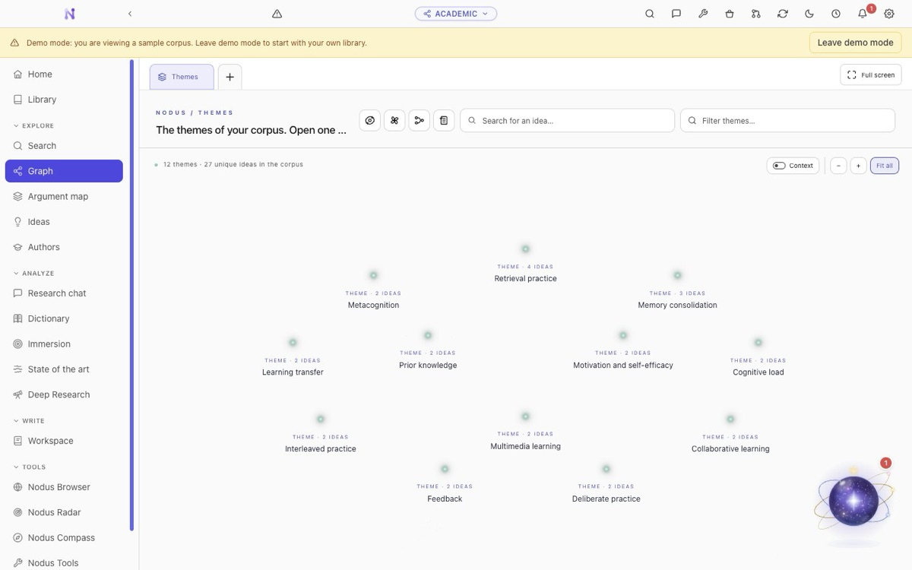</a> Academic vault: a knowledge graph of themes</td>
    <td align="center" width="33%"><a href="https://github.com/jorgepb96/nodus">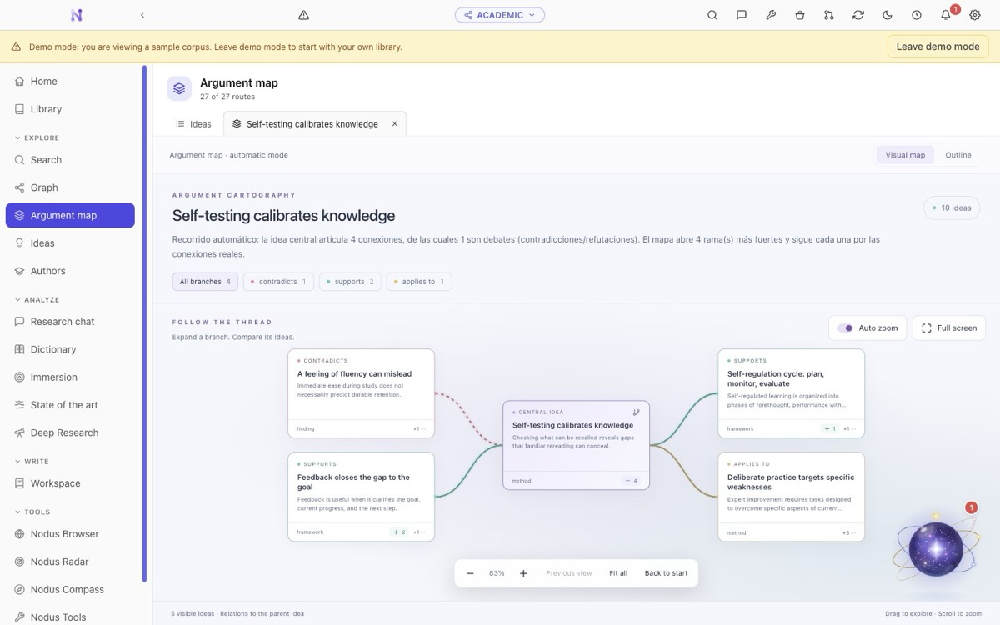</a> Argument map of connected claims</td>
    <td align="center" width="33%"><a href="https://github.com/jorgepb96/nodus">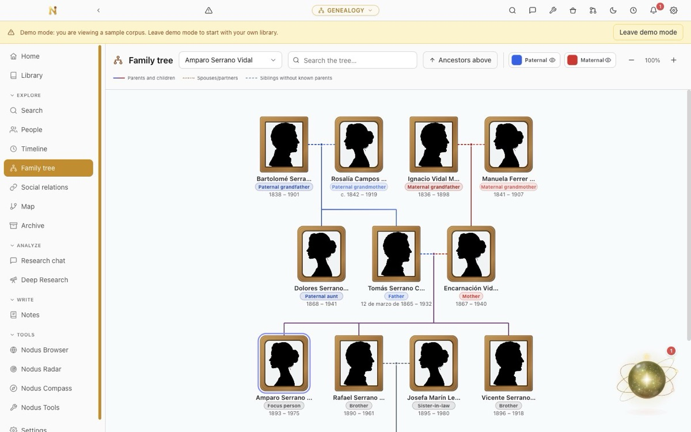</a> Genealogy vault</td>
  </tr>
  <tr>
    <td align="center" width="33%"><a href="https://github.com/jorgepb96/nodus">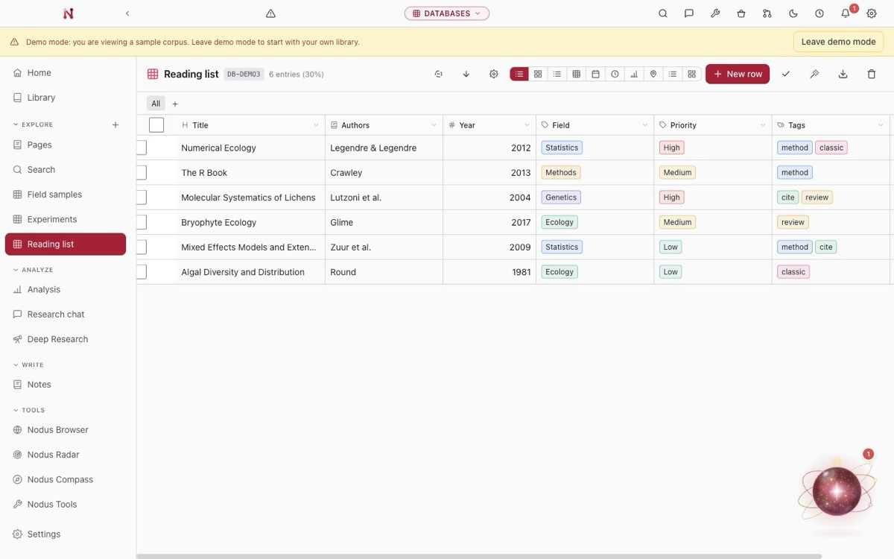</a> Databases vault</td>
    <td align="center" width="33%"><a href="https://github.com/jorgepb96/nodus">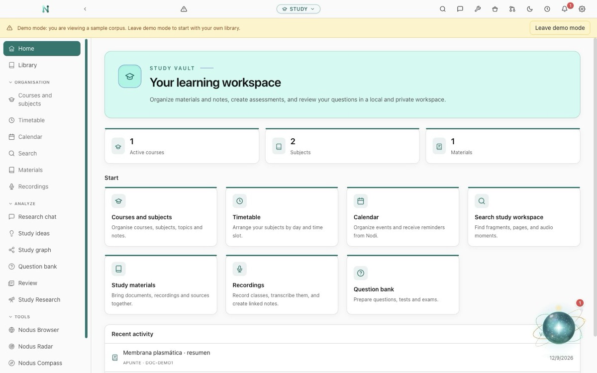</a> Study vault</td>
    <td align="center" width="33%"><a href="https://github.com/jorgepb96/nodus">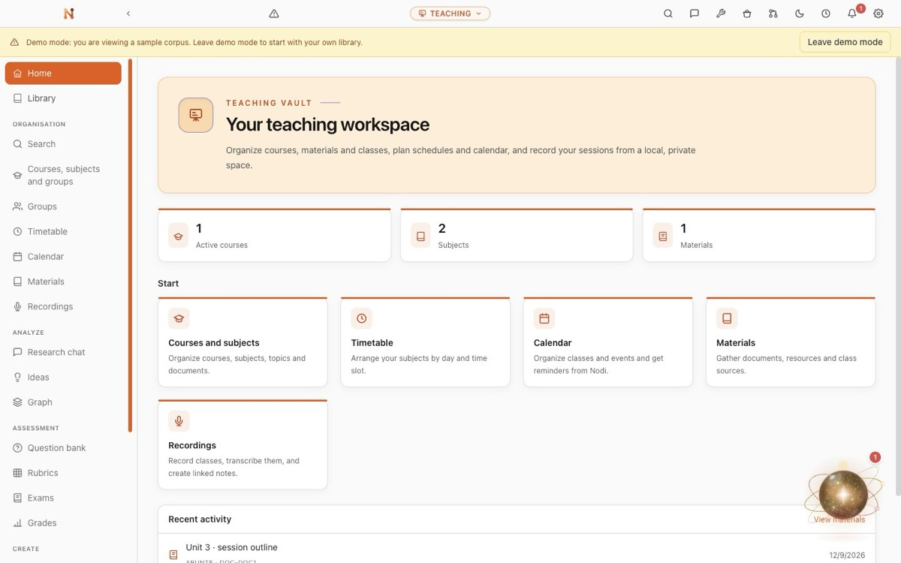</a> Teaching vault</td>
  </tr>
</table>

###  Nodus Imago

**The app closest to my own research.** Nodus Imago is an open-source desktop app for working with photographs, engravings and other visual sources. It is made for historians, art historians, archivists and anyone who looks after a visual collection.

- **Catalogue.** Build image databases with your own fields. Import from CSV, Tropy, IIIF manifests, Notion or Nodus. Dates stay as cataloguers write them (“c. 1860”, “1950s”) and still work in filters and timelines.
- **Search by text and by image.** Find images by exact words, by meaning or with another image. Mark a detail and find it inside every other photograph.
- **Describe with AI.** Generate descriptions, tags from your own vocabulary and transcriptions of backs, stamps and captions. Every result is a proposal you approve.
- **Restore.** Create restored, repaired or colourised versions that stay apart from the original.
- **Compare historical photographs.** Find other prints and crops of the same photograph, overlay them, and set a view next to present-day images in *Then and now*.
- **Analyse.** Frequencies, cross-tabs with chi-square and Cramér’s V, co-occurrence, trends, and agreement between classifications.
- **Map, timeline and network.** Place images on a map with the direction the camera faced, order them by period and see which places, people and subjects appear together.
- **Link and cite.** Connect records to Wikidata, Getty and Iconclass, and copy citations in Chicago, ISO 690 or APA.

Local AI or the provider you choose, on macOS, Windows and Linux.

**[Download](https://github.com/jorgepb96/nodus-imago/releases/latest) · [Source code](https://github.com/jorgepb96/nodus-imago)**

<table>
  <tr>
    <td align="center" width="33%"><a href="https://github.com/jorgepb96/nodus-imago">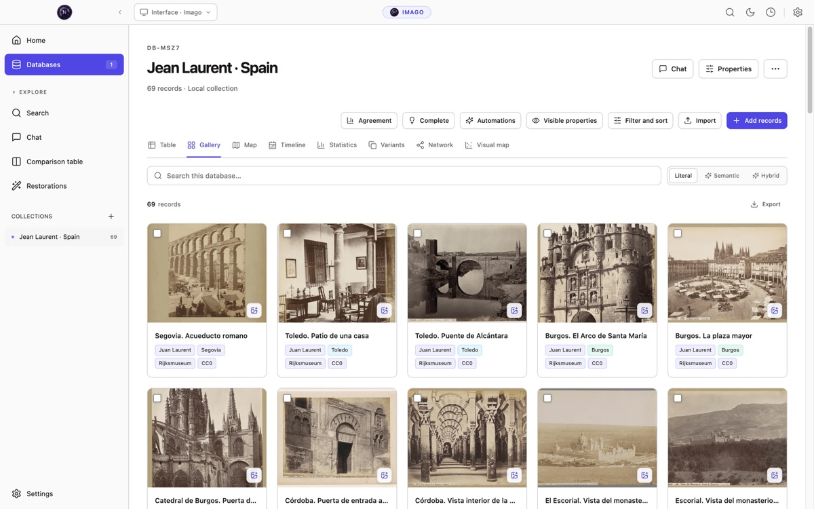</a> Catalogue gallery</td>
    <td align="center" width="33%"><a href="https://github.com/jorgepb96/nodus-imago">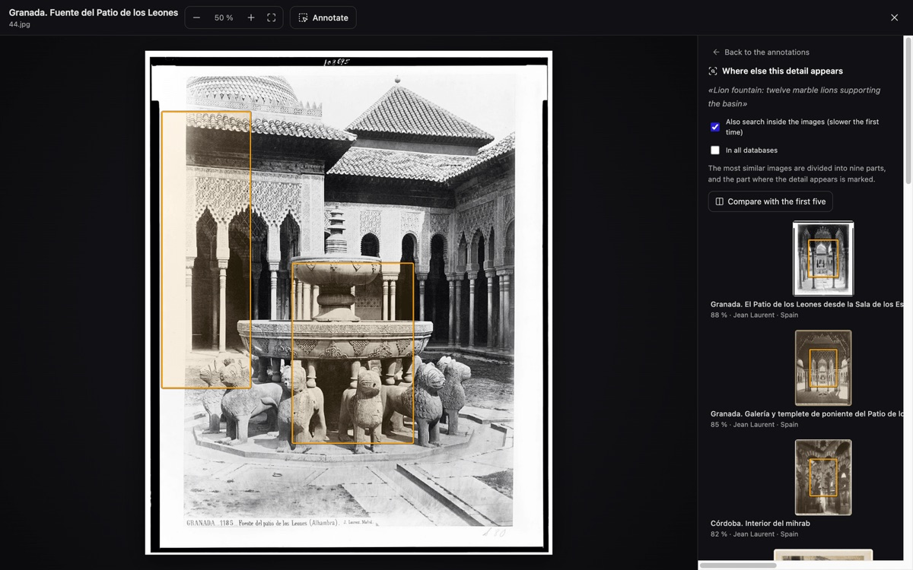</a> Search for a detail in other photographs</td>
    <td align="center" width="33%"><a href="https://github.com/jorgepb96/nodus-imago">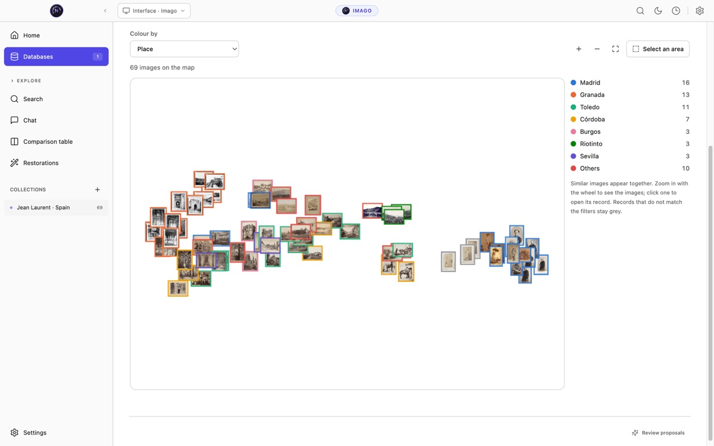</a> Visual map of the collection by likeness</td>
  </tr>
  <tr>
    <td align="center" width="33%"><a href="https://github.com/jorgepb96/nodus-imago">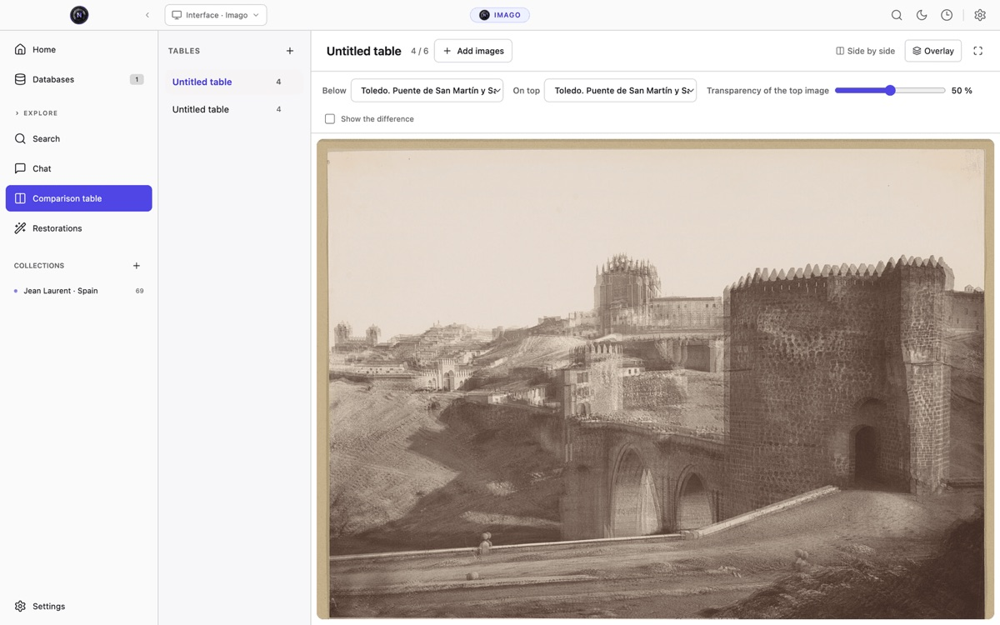</a> Two prints of the same view, overlaid</td>
    <td align="center" width="33%"><a href="https://github.com/jorgepb96/nodus-imago">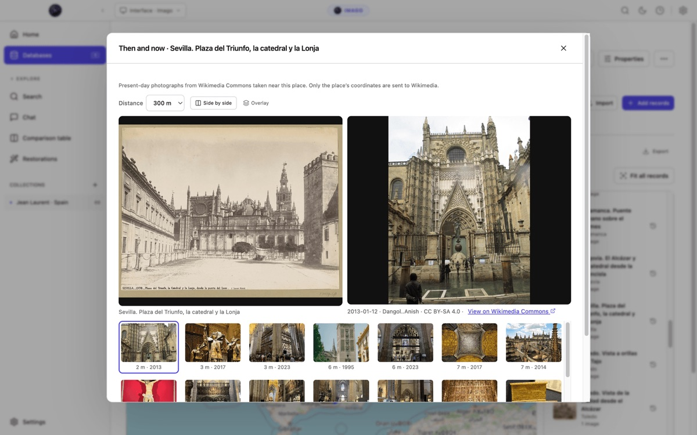</a> Then and now</td>
    <td align="center" width="33%"><a href="https://github.com/jorgepb96/nodus-imago">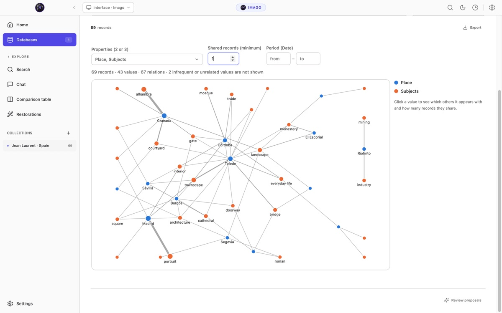</a> Network of places and subjects</td>
  </tr>
</table>

Screenshots show photographs by Jean Laurent and his studio from public collections. See the [image credits](https://github.com/jorgepb96/nodus-imago/blob/main/docs/screenshots/README.md).

### Mobile companions

The Nodus ecosystem continues on iPhone and iPad.

<table>
  <tr>
    <td width="50%" valign="top"> <b><a href="https://github.com/jorgepb96/nodus-mobile">Nodus Link</a></b> · iPhone · iPad Your Nodus Research on the go: Deep Research reports, ideas and notes, the dictionary and podcasts, over a private connection to your desktop. <a href="https://github.com/jorgepb96/nodus-mobile">Repository</a></td>
    <td width="50%" valign="top"> <b><a href="https://github.com/jorgepb96/nodus-reader">Nodus Reader</a></b> · iPhone · iPad · Mac soon Read EPUB and PDF with highlights and notes, and listen to your library with AI voices that run on your device. <a href="https://testflight.apple.com/join/SjCk8AZ1">TestFlight beta</a></td>
  </tr>
  <tr>
    <td width="50%" valign="top"><a href="https://github.com/jorgepb96/nodus-presenter">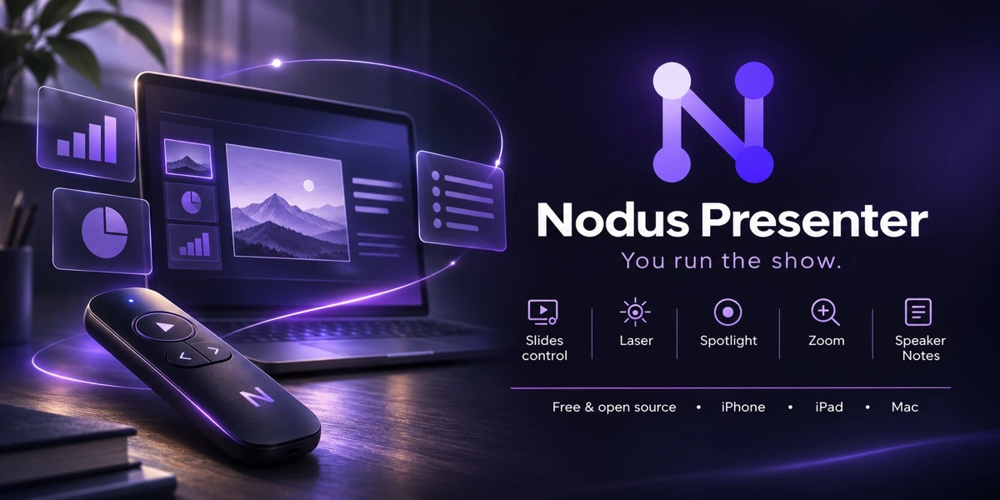</a> <b><a href="https://github.com/jorgepb96/nodus-presenter">Nodus Presenter</a></b> · iPhone · iPad Run Nodus Research presentations from your phone: slides, speaker notes, laser, spotlight and zoom. <a href="https://apps.apple.com/us/app/nodus-presenter/id6818107823">App Store</a></td>
    <td width="50%" valign="top"><a href="https://github.com/jorgepb96/nodus-drift">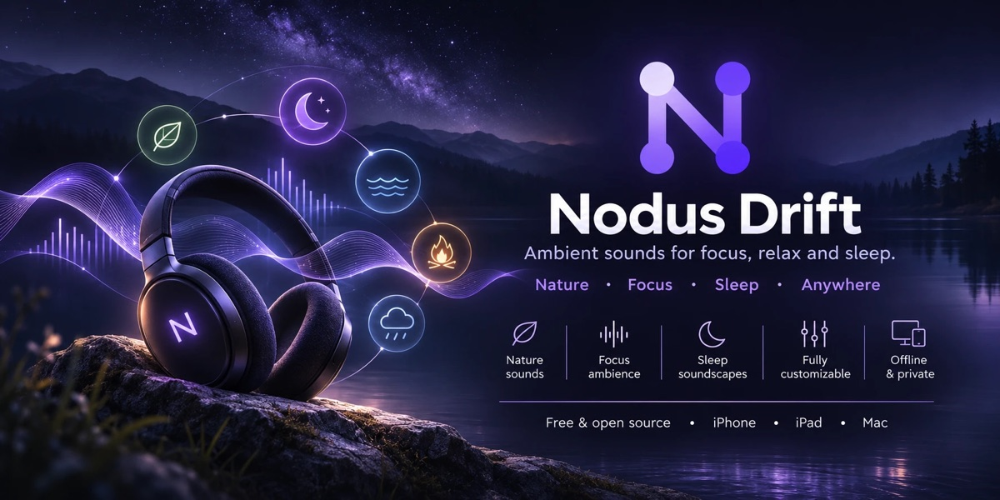</a> <b><a href="https://github.com/jorgepb96/nodus-drift">Nodus Drift</a></b> · iPhone · iPad Ambient sounds for focus, rest and sleep: 89 sounds, mixes of up to six, fully offline. <a href="https://testflight.apple.com/join/kAXnsjJS">TestFlight beta</a></td>
  </tr>
</table>

---

If Nodus is useful in your work, a star on its repositories helps other researchers find it.

